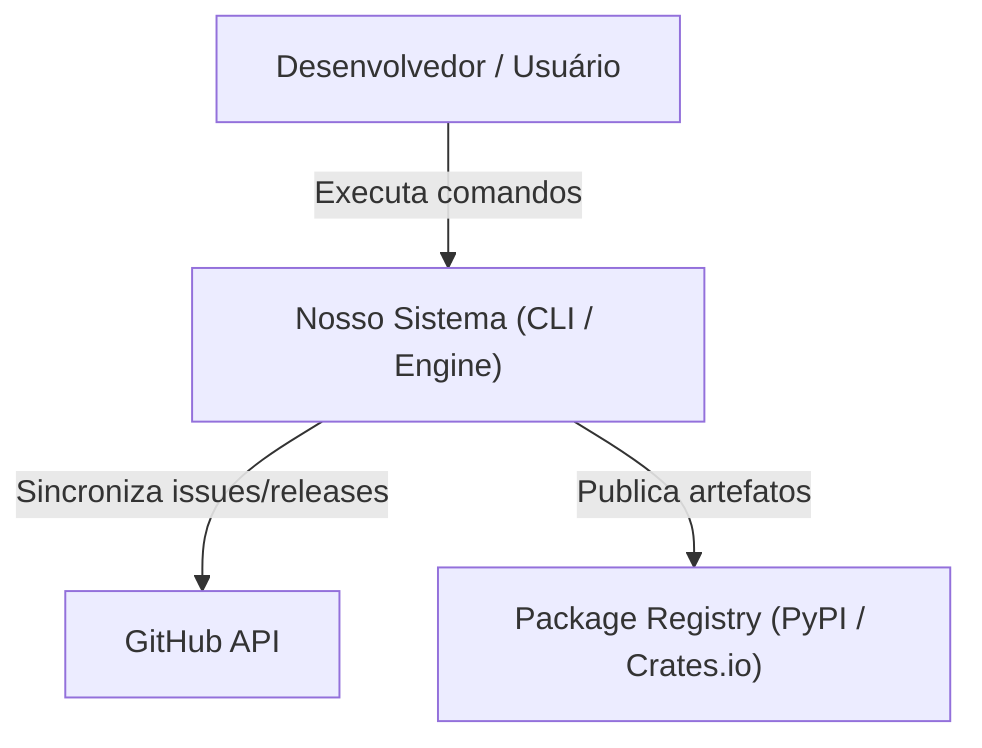
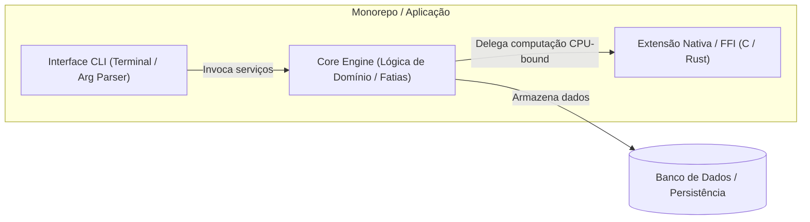
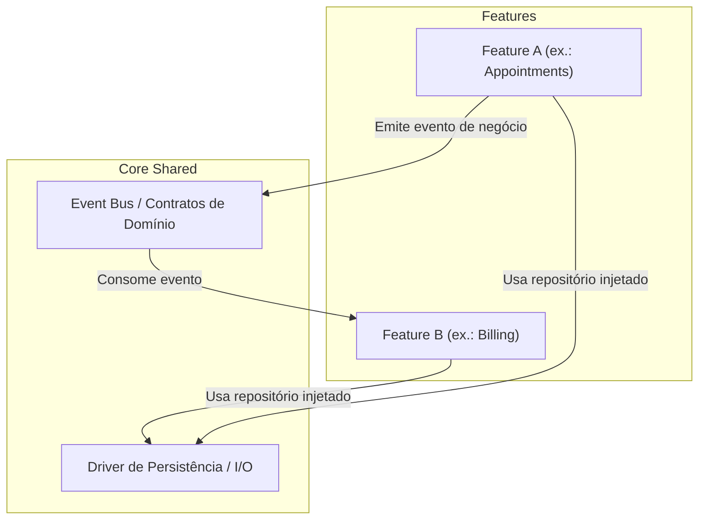

# Guia de Diagramas C4 com Mermaid

Para documentar arquiteturas vivas sem depender de ferramentas visuais externas, utilize diagramas Mermaid embutidos nos arquivos markdown.

---

## 1. Nível 1: Diagrama de Contexto de Sistema (System Context)
Mostra os atores humanos, o sistema sob análise e as integrações externas fundamentais:

---

## 2. Nível 2: Diagrama de Contêineres / Módulos (Container / Top-Level Architecture)
Mostra como os módulos de alto nível se organizam e comunicam:

---

## 3. Nível 3: Diagrama de Fatias Verticais e Componentes
Mostra o isolamento entre features e a camada core:

